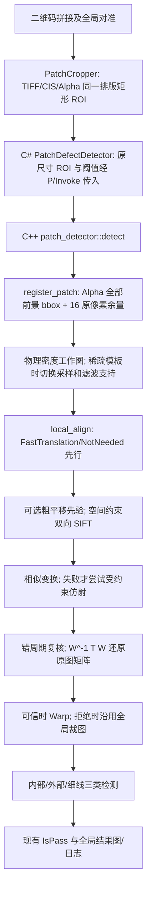

# 零件级局部配准统一化：当前流程与验收基线

日期：2026-10-23。阶段更新（2026-10-24）：**流程复盘完成，八件的同名结构已由用户确认；独立离线统一流程首轮试验未达到精度验收，未改生产 DLL。** [首轮标注核验](UnifiedRegistration/AnnotationAudit_20261023.md)与[确认版离线试验](UnifiedRegistration/OfflineTrial_20261024.md)分别说明点位证据及实验结果。本报告的“应用/拒绝”是程序行为，不代表人工确认的正确/错误。

后续验收口径按用户提出的约 0.6mm 检测目标修订，详见[5～6px 几何目标与功能验收说明](UnifiedRegistration/AcceptanceRevision_20261024.md)；原 2px 是历史目标，不再作为现有 87 个人工点的直接通过/失败判据。

## 1. 真实调用链

对应入口：[裁图](../../Services/PatchCropper.cs)、[C#接口](../../Services/PatchDefectDetector.cs)、[原生检测](../../Native/src/patch_detector.cpp)、[窗口与坐标](../../Native/src/patch_registration.cpp)、[候选与质量](../../Native/src/patch_alignment.cpp)、[周期复核](../../Native/src/patch_periodicity.cpp)。

### 当前分支及先后顺序

| 阶段 | 当前行为 | 容易造成的结果差异 |
|---|---|---|
| 裁图 | `LayoutOriginYmm` 影响同一排版矩形在三张大图中的位置；零件当前无独立对象掩膜 | 目标即使完整，相邻二维码进入矩形后仍能改变整个前景 bbox |
| 工作图 | 默认3工作像素/mm、宽至少500、长边≤1200、面积≤100万；模板特征数1～15改为2.5px/mm并增加64工作像素滤波支持 | 少数特征跨过15/16临界点会切换采样与边界条件 |
| 快速路 | 轮廓距离场估计平移；可直接 `NotNeeded` 或应用 `FastTranslation` | 后续 SIFT 不一定执行；轮廓均值下降不保证四角准确 |
| SIFT | 最多100个空间均衡点；±60原像素候选、描述子距离≤200、ratio0.70、双向一致；部分大位移有粗平移先验 | 图案重复、采样位置或先验变化会改变匹配集合 |
| 模型 | 固定种子、3原像素 RANSAC；相似先求解，当前也可能生成半量相似/内点中位数平移；相似失败才求受约束仿射 | 最终矩阵可能有不同来源，早通过的相似结果不会与仿射比较 |
| 验收 | 几何范围、内点比例/覆盖/RMS、轮廓均值与3×3分区、最后检查竞争周期 | 当前轮廓精修会改变原始SIFT矩阵；个别分区可成为退化点 |
| 回退 | 拒绝矩阵后照常使用 H0 裁图并计算缺陷，最终仍按 `IsPass` 汇总 | 仅部分原因记录“需复核”文字，整体无结构化待复核状态 |

坐标方向统一为 **CIS → TIFF Alpha**。`register_patch` 的工作图包含像素中心与窗口原点，矩阵经 `W^-1 T_work W` 还原为原图；`DefectDetectScale` 影响差分尺度，不应改变原图配准估计。质量检查和最终差分都会受到 CIS 二值阈值影响。

## 2. 为什么此前会“救一个、退一个”

已确认的结构性风险：

1. 模板窗口以**裁图里所有 Alpha 前景**确定。img/2 的 042… 顶部出现相邻二维码，bbox 从零行起，16px真实余量检查失败；移除明显碎片的独立试验仍仅6组匹配、4内点，说明它还存在稀疏特征问题。
2. 快速平移、半量相似、受约束仿射采用不同的生成及进入条件。算法在某条路径提前返回时，并不知道另一模型是否会使跨区域误差更小。
3. 现有“裁图位置一致性”测试主要是把相同像素共同放入更大零背景画布；它证明了特定共同平移时的坐标换算，却不覆盖邻居混入、真实上下文不足或重新采样。
4. 一个已知旋转0.12°、统一缩放1.001的稀疏合成例走 FastTranslation：平均轮廓约4.98→1.73px，四角相对真值仍错4.3～6.4px。因此**接受矩阵及平均分改善都不足以证明全件正确**。
5. img/2 的 2b…与4b…均回退全局：前者相似9/42、覆盖0.049，后者相似12/58、仿射15/58。3/6/10原像素RANSAC试验增加了部分内点，却使某些区域的轮廓评分退化。这些证据不能证明两件必然为剧烈非线性，也不支持直接放宽门槛。

## 3. 冻结的八件人工核对集

原尺寸 Alpha/CIS 冻结在 [输入目录](UnifiedRegistration/inputs)，含逐文件 SHA256 的 [清单](UnifiedRegistration/manifest.json)。[人工复核说明](UnifiedRegistration/README.md)解释了图像颜色、坐标和填写方式。图像均为**局部配准之前**的真实 ROI；Alpha 60、CIS 120 阈值用于预览叠加。

对 img/2 五件，还逐像素比对了冻结原始 Alpha 经阈值60二值化后的结果与用户 14:27 批次“裁切结果”中的各 `*_alpha.png`：尺寸和全部像素一致。后者是显示用二值图，故其文件哈希与原始 Alpha PNG 本来就不相同。

| 来源 | 零件 | 当前程序行为 | 核对重点（非人工结论） |
|---|---|---|---|
| img/2 | 04200… | `InsufficientContext`，未应用 | 顶部二维码是否属于相邻对象；三条长条上/下端对应关系 |
| img/2 | 2b728… | 相似/仿射拒绝 | 三层重复齿形有没有一致的物理对应，是否发生错周期 |
| img/2 | 3b728… | `SimilarityConditional` 应用 | 以前已改善的短横向重复图案；确认是否全件正确及有无真缺陷 |
| img/2 | 4b728… | 相似/仿射拒绝 | 上部、内凹、下部的对应点能否同属轻微仿射 |
| img/2 | 5b728… | 相似/仿射拒绝 | 防止新方案改善三个目标却使另一同批件退化 |
| img/3、Y=62 | 04200… | 稀疏策略下相似变换应用 | 同类长条在不同裁图上下文下的稳定性 |
| 17-13-15 | d73d… | 受约束仿射应用 | 跨文字、侧缘、细结构的真实对应关系 |
| 17-13-15 | ed18… | 受约束仿射应用 | 大幅面多区域仿射收益及局部退化风险 |

本段记录的是冻结初期状态；八件后来已有用户确认版标注，见 `UnifiedRegistration/annotations-confirmed-20261024.json`。模板侧建议点可由预览脚本生成到 `obj/PatchNativeValidation/UnifiedRegistrationReview/candidate-landmarks.csv`，不能直接用于计算精度；空白的 `landmarks.csv` 与 `review-labels.csv` 是备用填写模板。

八件总览与九区放大图可运行 `UnifiedRegistration/make_review.py` 重建到 `obj/PatchNativeValidation/UnifiedRegistrationReview`。其中绿色为 TIFF 独有前景，洋红为 CIS 独有，白色为共有；这些是 H0 裁图下的示意，不能直接用来算误检率。

## 4. 统一实现的约束与验收口径

- 用固定目标矩形定义检测主体；搜索上下文提供真实图像余量，但不改核心缺陷 ROI、`GlobalRoi` 和坐标系。邻居侵入且无法唯一归属时报告待复核。
- 在统一物理采样、固定特征预算和同组匹配下并行评价相似/受约束仿射；轮廓只能评分。相近时选相似；仿射需要多个区域的明确收益，且任何有效区域不得明显退化。
- 保留空间先验、确定性RANSAC、模板精确缓存与周期复核；不把现有旧参数直接解释成物理真值。
- 引入结构化配准状态与独立C ABI查询，不更改v1 `CisPatchSummary` 布局。配准不可靠的差分图仅供复核，批次可信NG、待复核和Pass分别汇总。
- 手工真值采用原尺寸独立对应点：原定目标为合格样本95%误差≤2px、最大≤5px。**2026-10-24 补充：用户估计当前点击误差约每张图 3px，因此这批点不能单独认证 2px 目标；目标不自动放宽，需另建高精度真值或补充功能性验收依据。** 额外报告正确接受、错误接受、可解却拒绝、不可解/证据不足四类；报告重复图案、不同裁框、并行/缓存次序和真缺陷保留。
- 同机相同保存条件下，零件批次典型及慢批次耗时增幅均不得超过20%；不能只靠小样本单次跑分宣称节拍通过。

本节是当时的基线记录；后续正式实现和验收状态以 `UnifiedRegistration/Progress_20261024.md` 为准。先前 img/2 的平均轮廓距离及缺陷数仅用于历史诊断，不作为人工精度目标的证明。
