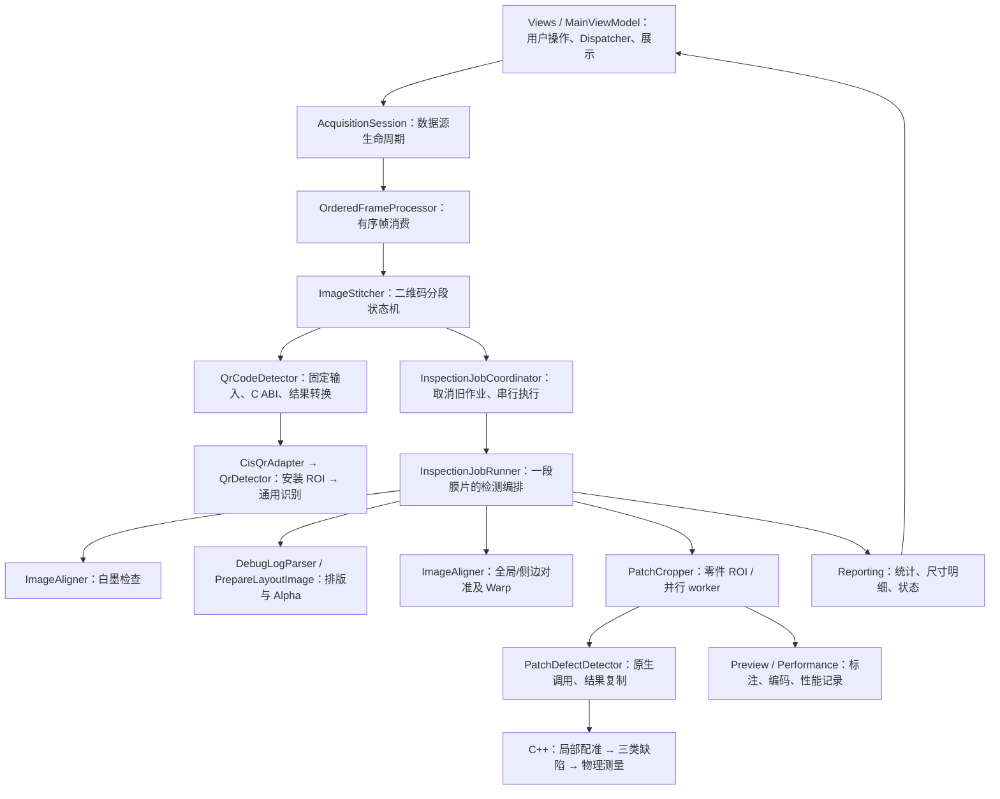
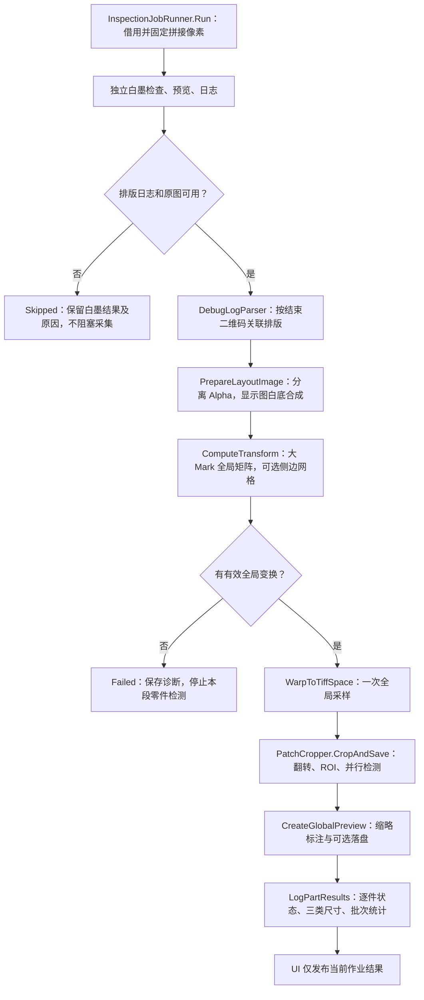

# 职责边界与调用链

返回 [交接入口](README.md)。算法参数细节见 [全局指南](../项目全局导航与开发指南.md)，本页回答“去哪里改、不要放在哪里”。

## 1. 三层边界

图中的先后执行顺序以第 3 节为准。箭头表示调用关系，**不表示每个框都是独立线程**。

## 2. 输入帧与拼接链

| 上游 → 下游 | 数据与关键边界 |
|---|---|
| [MainWindow](../Views/MainWindow.xaml.cs) → [MainViewModel](../ViewModels/MainViewModel.cs) | 建立绑定、管理生命周期；缩放拖动只改变显示 |
| [MainViewModel.Acquisition](../ViewModels/MainViewModel.Acquisition.cs) → [AcquisitionSession](../Services/AcquisitionSession.cs) | 选择 `CisCameraEngine` 或 `OfflineImageSource`，保存本次采集参数快照 |
| 数据源 `FrameReady` → `OnFrameReady` → [OrderedFrameProcessor](../Services/OrderedFrameProcessor.cs) | 生产者交出独立像素数组；消费者按顺序处理；处理队列满触发停采保护 |
| `ProcessQueuedFrame` → [ImageStitcher.ProcessOwnedFrame](../Services/ImageStitcher.cs) | 当前帧检测；必要时上一帧尾部+本帧头部组合检测 |
| 拼接器 → [QrCodeDetector.Detect](../Services/QrCodeDetector.cs) | C# 同步 P/Invoke → [cis_qr_adapter.cpp](../Native/src/cis_qr_adapter.cpp) → [qr_detector.cpp](../Native/src/qr_detector.cpp) |
| `StitchCompleted` → [MainViewModel.Inspection](../ViewModels/MainViewModel.Inspection.cs) | 独立 `StitchedImageResult`，带结束二维码文本、全局 Y、段起点和码宽高 |

拼接器由单一消费者使用：等待首码 → 累积 → 第二码完成一段并成为下一段首码。切点超出当前帧时先完成延迟切割；连续未命中达到门槛后放弃旧段。不要从 UI、保存线程再次调用拼接器。

## 3. 一段膜片的检测顺序

**无 Alpha 的特殊边界：**目前主线可以继续运行，但 `PatchCropper` 没有建立差分模板，不执行零件检测。现有日志“使用统一阈值检测”不准确，本轮只补注释与文档，不改判定行为。

## 4. 本轮拆分后从哪里阅读

使用 `partial` 是保持原有类型/调用点的物理拆分；没有额外创建服务容器或新的公有 API。

| 文件 | 应放的职责 | 不应放的职责 |
|---|---|---|
| [InspectionJobRunner.cs](../Services/InspectionJobRunner.cs) | 阶段顺序、提前退出、取消边界、整段资源释放 | 逐像素合成、长篇日志格式化 |
| [InspectionJobRunner.LayoutImage.cs](../Services/InspectionJobRunner.LayoutImage.cs) | Alpha 提取与白底合成 | 文件关联、UI 更新、缺陷规则 |
| [InspectionJobRunner.Reporting.cs](../Services/InspectionJobRunner.Reporting.cs) | 三类尺寸、产品/工程状态、白墨日志 | 再次阈值过滤、重新测量面积 |
| [PatchCropper.cs](../Services/PatchCropper.cs) | 坐标裁切、并行 worker、缓存生命周期 | 全局图绘制细节 |
| [PatchCropper.Preview.cs](../Services/PatchCropper.Preview.cs) | 仅在显示副本标注、编码和保存 | 修改传入大图或缺陷坐标 |
| [PatchCropper.Performance.cs](../Services/PatchCropper.Performance.cs) | 分位数、内存采样、CSV 串行写入 | 调整算法参数或产品 Pass/Fail |
| [qr_finder_patterns.cpp](../Native/src/qr_finder_patterns.cpp) | 模糊定位框证据、三点组和模块结构检查 | 发布文本、CIS ROI、重试预算 |
| [qr_recovery.cpp](../Native/src/qr_recovery.cpp) | 透视、低对比、失焦恢复调度 | 重复实现定位框结构评分 |
| [patch_template_cache.cpp](../Native/src/patch_template_cache.cpp) | 模板签名、精确比较、特征复用和锁 | 求变换矩阵或判断配准质量 |
| [patch_alignment.cpp](../Native/src/patch_alignment.cpp) | 当前正式局部配准：工作坐标、SIFT/RANSAC、相似/受约束仿射及必要时的局部单应性；安全门控与质量降级状态 | 批次缓存管理、文件保存或更改缺陷 ROI |
| [patch_region.cpp](../Native/src/patch_region.cpp) | 完整结构共同定位工作窗口、检查边界碎片归属；坐标与类型见 `patch_region.h` | 修改检测 Alpha、生成变换或判定缺陷 |
| [patch_periodicity.cpp](../Native/src/patch_periodicity.cpp) | 重复位置证据与歧义拒绝 | 自行选择另一周期、直接改变产品 Pass/Fail |

## 5. 核心算法入口地图

- 二维码主链：`QrDetector::detect`；CIS 特有 ROI 在适配层。定位框证据不是成功解码，只有解码器返回非空文本才成功。
- 大 Mark：`alignment_global.cpp` 编排，`alignment_marks.cpp` 提取候选/倾斜行/缺点配对；侧边残差在 `alignment_side_grid.cpp`，最终采样在 `alignment_warp.cpp`。
- 白墨：`alignment_white_ink.cpp`；C# `ImageAligner.WhiteInk.cs` 转换结果，`Diagnostics.cs` 画预览。墨量百分比是灰度相对指标，不是墨水体积测量。
- 零件：`patch_detector.cpp::detect` 编排，`patch_alignment.cpp::register_patch` 计算并检查局部矩阵，`patch_periodicity.cpp` 复核周期；`patch_fine_line.cpp::fine_line` 执行缺陷连续性复核。
- 普通差分：模板有/实拍无为内部，实拍有/模板无为外部；连通域跨出边缘屏蔽带即保留原差分分量，不用剩余碎片面积代替整块面积。
- 细线：从独立细节图找缺口，核对截面、两端结构及错位解释，再执行长度/线宽门槛。与普通内部容差解耦，但仍共享图像阈值和边缘屏蔽范围。

当前局部对准只从 SIFT 对应点与 RANSAC 获取候选矩阵；轮廓只比较候选与全局图、决定优质或降级，不再做轮廓平移或距离场精修。开关开启表示尝试而非强制应用：`Applied/AppliedDegraded` 使用局部图，`NotNeeded/Review/Error` 使用全局图，其中降级和回退会独立提示复核，三类缺陷照常统计。原先两套未编译的旧实现已删除，现行文件名统一为 `patch_alignment.cpp`。

## 6. 文件拆分与命名约定

- C# 保持“类名 + 职责” partial 文件：采集、作业、预览、日志各自有明确依赖；配置字段、类名、命名空间和公开接口不因简化文件名而更改。
- C++ 保持“领域 + 职责”短名：`qr_*`、`alignment_*`、`patch_*`。本轮将 `patch_local_align` 归并为唯一的 `patch_alignment`，将目标区域处理独立为 `patch_region`。
- `register_patch` 内的候选求解与门控仍放在一起，便于核对同组证据和回退顺序；不将每个小函数拆成独立文件。`ImageStitcher` 的状态迁移也保持单一消费者内的完整视图。
- `Tools/*Regression/Legacy` 是可编译的冻结对照，不是生产算法。修改正式代码不顺手更新对照，以免失去比较意义。
